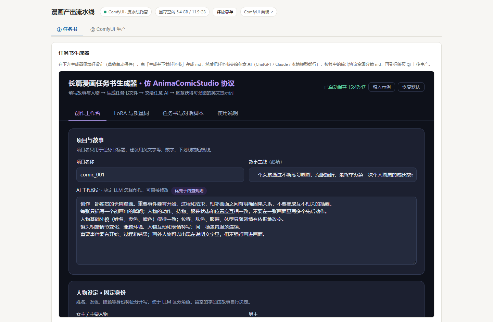
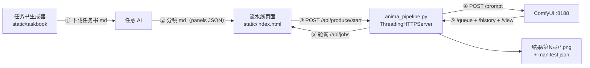
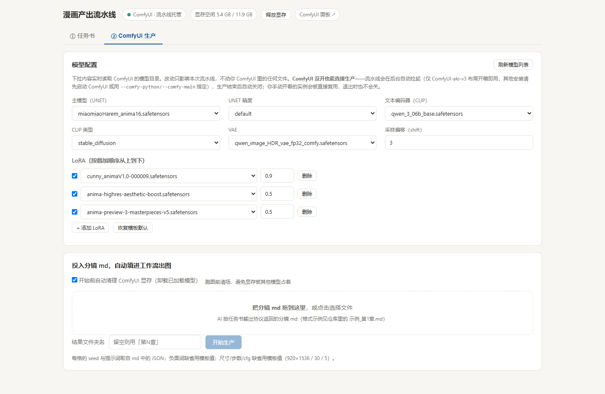
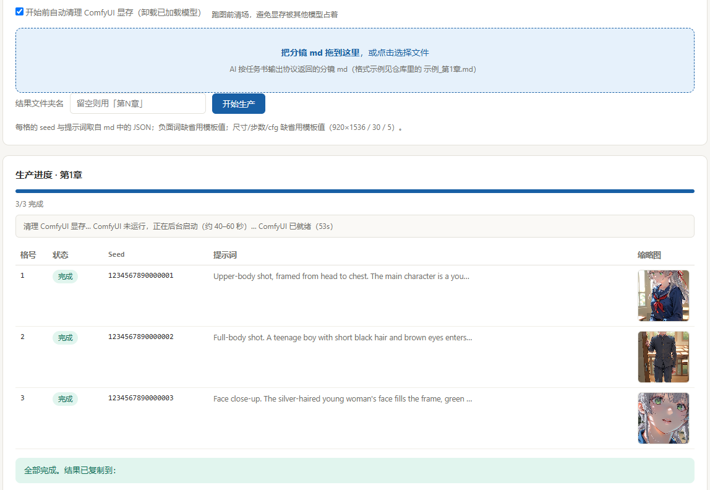

# comfyui-anima-comic-pipeline

一条本地 **漫画产出流水线**：用 Anima 模型在 ComfyUI 上出图，脚本由 AI 写。

把 **任务书 → 任意 AI 写分镜 → ComfyUI 自动出图** 串起来，纯 Python 标准库，**零依赖**。

本项目**重点在技术分享**：怎么把「LLM 写分镜」和「ComfyUI 批量出图」接成一条能跑的链，
以及过程中踩到的坑（见 [开发思路](#开发思路)）。

- **①任务书**：页面内置任务书生成器，填好故事与人物 → 下载一份自包含的 `.md` 任务书
- **→** 把任务书交给**任意 AI**（ChatGPT / Claude / 本地模型都行），按任务书里的输出协议拿回分镜 md
- **②生产**：把分镜 md 拖进页面 → 自动填进 Anima 文生图工作流 → 逐格出图，结果按章节落盘



## 技术路径



文字版：**任务书生成器**（纯静态页）产出 md → 使用者交给**任意 AI** 拿回分镜 md →
**流水线页面**把它 POST 给 **`anima_pipeline.py`**（纯标准库 HTTP 服务）→ 后端解析 JSON 块、
拼装 ComfyUI 工作流并 `POST /prompt` → 轮询 `/queue`、`/history`，再用 `/view` 把图拉回来落盘 →
前端每 1.5s 轮询 `/api/jobs` 更新进度。

整条链上没有数据库、没有框架、没有 pip 依赖，状态全在内存里。

## 你需要有什么

| 依赖 | 说明 |
| --- | --- |
| **ComfyUI** | 必需的出图引擎。已在跑就直接复用；没跑则由流水线自动拉起、用完自动关 |
| **Anima 文生图模型** | UNET + 文本编码器(CLIP) + VAE，可选 LoRA。在页面「模型配置」里下拉选择（实时读取你 ComfyUI 的模型目录） |
| **Comfyroll 自定义节点** | 工作流模板用到它的 `CR Prompt Text` / `JoinStringMulti` 节点 |
| **Python 3.8+** | 只用标准库，无需 pip 安装任何东西 |

> **平台**：目前在 **Windows** 上验证（自动拉起 / 自动关闭依赖 Windows 的
> `create_no_window` 与 `taskkill`）。非 Windows 下若已经手动开好 ComfyUI，
> 也能复用出图，只是自动拉起不生效。

> 没装 Comfyroll 也不用慌：`workflow_template.json` 是一份普通 ComfyUI API 工作流，
> 换成你自己的文生图工作流即可（保证最后有一个 `SaveImage` 节点）。

## 快速开始

```bash
python anima_pipeline.py
```

浏览器打开 **http://127.0.0.1:8790** 。

常用参数：

```bash
python anima_pipeline.py --port 9000                       # 换端口
python anima_pipeline.py --comfy-url http://192.168.1.10:8188   # 复用远程 ComfyUI
python anima_pipeline.py --comfy-python <python.exe> --comfy-main <ComfyUI/main.py>
python anima_pipeline.py --keep-comfy                      # 出图后不关引擎（连续出好几章时用）
```

`--comfy-python / --comfy-main` 只在**自动拉起**时用得到。默认值是 `ComfyUI-aki-v3`
的布局；其他安装请手动先启动 ComfyUI（流水线会直接复用），或用这两个参数指定路径。
`Ctrl+C` 退出。

## 用法

**① 任务书**
在生成器里填故事、人物、生图参数（草稿自动保存），点「生成并下载任务书 (.md)」。
把这份 md 整份发给任意 AI，按「多轮对话脚本」逐章要 JSON，每章存成一份 md。

**② 生产**
切到「② ComfyUI 生产」→ 把分镜 md 拖进上传区 →（可选）调模型 / LoRA →
点「开始生产」。每格依次进队列，缩略图可点开看大图，完成后给出结果文件夹路径。

分镜 md 的格式见 [`示例_第1章.md`](示例_第1章.md)：只要含一个带 `panels` 数组的
JSON 代码块就行，其余文字随意。



出图后：

```
结果/第N章/
├─ 01_id1.png  02_id2.png ...   每格一张
└─ manifest.json                每格的完整提示词、seed、所用模型配置
```



## 开发思路

### 为什么做成「独立网页 + HTTP 驱动 ComfyUI」，而不是一个自定义节点

- 任务书那一环跟 ComfyUI 毫无关系，塞进节点里只能做成很别扭的多步 UI；
- ComfyUI 的 HTTP API（`/prompt`、`/queue`、`/history`、`/view`）足够驱动整条出图链，
  不需要写节点、也不需要装任何 ComfyUI 插件；
- 独立进程才能顺手把「引擎开 / 关」也管起来（节点做不到，它跑在引擎里面）。
- 代价只是多敲一行 `python anima_pipeline.py`。

### AI 环节留空，工具只干两件事

不绑定任何 LLM API。工具负责「生成一份自描述的任务书」和「吃分镜 md 出图」，
中间那一步完全交给使用者自己选（网页版还是本地模型都行）。
好处是把**提示词工程**和**出图工程**解耦——**换 AI 不用改代码，调提示词不用碰工作流**。

### 中间格式：人类可读的 Markdown + 机器可解析的 JSON 块

分镜产物是「一份 md，里面有一个 json 代码块（围栏标成 json），块里是 `panels` 数组」：

- 对 AI 友好：任务书里的规则和 JSON schema 都能直接作为上下文；
- 对人友好：出图前可以直接手改某一格的 `prompt` / `seed` 再重跑；
- 对程序友好：从 md 里抓出 json 代码块 → `json.loads` 就完事，不需要写解析器、
  也不怕 AI 前后多写几段说明文字。
- 另外支持 `<!-- PIPELINE-PANELS-BEGIN/END -->` 标记做精确定位（可选）。

### 动态重建工作流的「加载链」

`workflow_template.json` 是一份普通 ComfyUI **API 格式**工作流。出图前，程序把模板里的模型加载节点
（`UNETLoader` / `CLIPLoader` / `VAELoader` / `LoraLoaderModelOnly` / `ModelSamplingAuraFlow`）
**整段丢弃，用固定 id 段重建**，再接回模板原有的采样与保存节点，并把每格的
prompt / seed / 尺寸 / 步数 / cfg 注入进去。

```python
# 加载链用固定 id 段重建，与模板自带的节点号隔离
N_UNET, N_CLIP, N_VAE, N_AURA = "870", "880", "881", "890"
```

这样**换模型、增删 LoRA、改精度都只是改这张图，不用回 ComfyUI 重新导出工作流**；
页面上那几个下拉框改的就是它。

### 收图走 HTTP，不读本地目录

图是用 `/view` 拉回来的，不去翻 ComfyUI 的 `output/` 目录。所以
`--comfy-url` 指向局域网里另一台机器也能用——出图的机器不必是跑流水线的机器。

### 引擎自管理：让「有没有开 ComfyUI」不再是使用者的问题

见下一节。设计上有一条硬规矩：**只关自己拉起的实例**（内部用 `_COMFY_OWNED` 标记区分），
使用者手动开的 ComfyUI 绝不动。

### 零依赖

只用标准库：`http.server` 当后端、`urllib` 调 ComfyUI、`subprocess` 管引擎。
目标是「装了 Python 就能跑」，不让下载的人先配半天环境。

### 踩过的坑（留给后来人）

- **不能靠「端口通不通」判断 ComfyUI 是否就绪**。系统代理会对本机请求返回 502 的 HTML，
  看起来像「连上了」。必须校验返回的 JSON 里有没有 `devices` 字段才算真就绪。
- **Windows 的 `SO_REUSEADDR` 允许多个进程绑同一端口**。调试时「改了代码没生效」，
  很可能是旧进程还占着端口、请求被随机分给了旧代码 —— 先
  `netstat -ano | findstr :8790` 确认监听者是不是自己。
- **无头拉起 ComfyUI 时，某些自定义节点会卡在交互确认上**。`stdin` 给了 `DEVNULL`，
  等不到输入就直接退出（日志里只有一行 `[safe-delete]...CONFIRM_REQUIRED`）。
  本例是 ComfyTV 的启动备份触发了批量删除确认，解法是用它自带的测试模式开关跳过
  —— 见 [常见问题](#常见问题)。
- **无头子进程别继承宿主的 `PYTHONPATH`**。IDE / 各种工具注入的路径会混进 ComfyUI 的
  import 搜索路径，用单独的锚点目录顶掉（见 `engine_env/`）。
- **`urllib` 默认走系统代理**。调本机 / LAN 服务时每次连接都被代理拖几秒，
  用 `build_opener(ProxyHandler({}))` 禁掉。

## ComfyUI 引擎自管理

不用手动管 ComfyUI。点「开始生产」时：

1. 探测 `127.0.0.1:8188`（严格校验返回的是 ComfyUI 的 JSON，避免被系统代理的 502 假信号骗到）
2. **已在跑**（不管谁起的）→ 直接复用，退出流水线时也不关它
3. **没在跑** → 后台静默拉起，日志写到 `logs/comfy_engine.log`，等就绪约 40–70 秒
4. **生产完成** → 自动关掉流水线拉起的实例（`--keep-comfy` 可让它常驻）

## 目录结构

```
comfyui-anima-comic-pipeline/
├─ anima_pipeline.py           主程序（纯标准库）
├─ static/index.html           网页界面（两个标签页）
├─ static/taskbook/index.html  任务书生成器（独立页面）
├─ workflow_template.json      Anima 文生图工作流模板（可替换成你自己的）
├─ engine_env/README.md        自动拉起用的环境变量说明
├─ screenshots/                README 配图
└─ 示例_第1章.md               分镜 md 格式示例
```

## 常见问题

**装了 ComfyTV，自动拉起的 ComfyUI 秒退？**
自动拉起的子进程会带 `COMFYTV_TESTING=1`，跳过 ComfyTV 在 import 阶段的启动备份
（否则无头进程会卡在删除确认上直接退出）。这个变量只影响自动拉起；你手动启动
ComfyUI 时没有它，ComfyTV 功能完整。详见 [`engine_env/README.md`](engine_env/README.md)。

**想换模型 / 改尺寸、步数、cfg？**
模型在页面上选。尺寸、步数、cfg 缺省值写在 md 的每格 JSON 里（不写则用模板默认
`920×1536 / 30 步 / cfg 5`）。想改默认值就编辑 `workflow_template.json`。

## 致谢

任务书协议仿自 **Butako11 / AnimaComicStudio** 的 `ComfyUI-Anima-Story` 节点组。

本仓库只包含代码，**不带任何模型权重**——Anima 模型请自行从模型作者处获取。

## 许可

[MIT](LICENSE)
